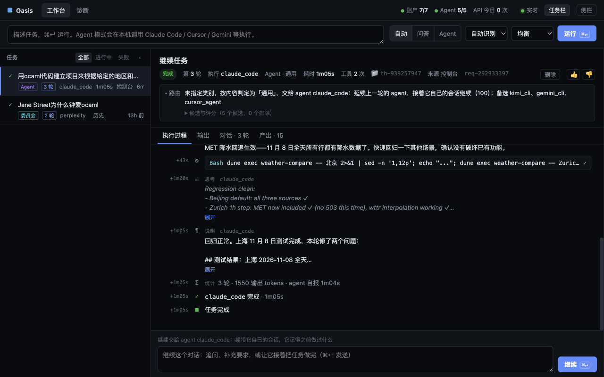
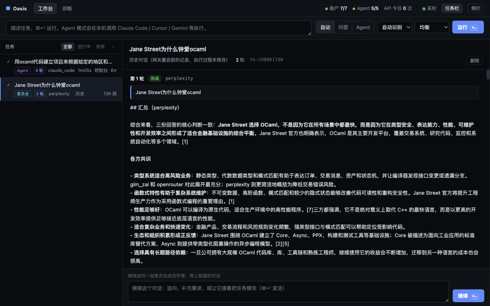
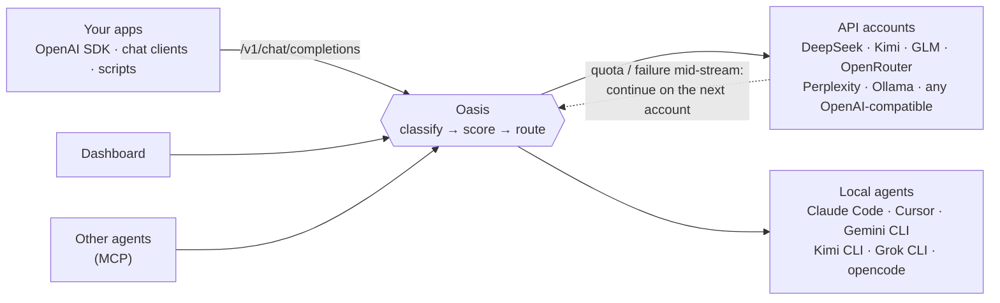

<div align="center">

# Oasis

**One local endpoint for every AI account and coding agent you already pay for.**

Oasis picks the right model or agent for each request, and when an account runs out of quota halfway through an answer, it hands the stream to another one. Your client never notices.

**English** · [简体中文](README.zh-CN.md)

</div>



## Why Oasis

You probably have more AI than you can use: a DeepSeek key, a Kimi plan, GLM, OpenRouter credits, Perplexity, a local Ollama, plus Claude Code, Cursor and Gemini CLI on your laptop. Each one is good at different things, priced differently and rate-limited differently. So you choose by hand every time, burn a flagship model on a trivial question, and still hit a quota wall in the middle of a long answer.

Oasis sits in front of all of them and makes that choice for you, per request.

## What you get

- **Drop-in OpenAI-compatible API.** Point any client, SDK or chat app at `http://127.0.0.1:9899/v1`, set `model` to `auto`, and keep working. Streaming and non-streaming both work.
- **Routing that explains itself.** Oasis classifies each task (coding, research, writing, analysis, general). It then scores every eligible account on model strengths, price, remaining budget, live latency, health, and the quality it has learned from your past results. You choose the goal: `balanced`, `fastest`, `best` or `cheapest`. Every decision, and every rejected candidate, is shown in the dashboard.
- **Seamless handoff in the middle of a stream.** If an account hits its quota or drops the connection while streaming, Oasis continues on the next account from exactly where the text stopped, with no repeated words. Your client receives one continuous answer. This is the feature Oasis was built around, and the self-test proves it in under a second.
- **Your local agents become workers.** Tasks that need tools, such as writing code, running commands or browsing, go to Claude Code, Cursor Agent, Gemini CLI, Kimi CLI, Grok CLI or opencode on your machine. You watch their thinking, tool calls and output live. Each conversation gets its own working directory, and follow-ups resume the agent's own session, so it remembers what it already did.
- **Committee mode.** Send one question to up to three accounts at once and get a merged answer that shows where they agree and where they differ.
- **A real dashboard** at `http://127.0.0.1:9899/` lists your tasks with their routing explanations, live progress and produced files. You can follow up, stop or delete from there.
- **MCP server** at `POST /mcp`, so other agents can ask models, hand tasks to your local agents, and message each other through Oasis.
- **Small and private.** Oasis is a single binary under 10 MB. Routing takes about 2 µs per request. All state lives in `~/.oasis` on your machine, and API keys stay in environment variables, never in config files.



## How it works



## Quick start

You need macOS or Linux and the [Riot](https://github.com/leostera/riot) OCaml toolchain.

```bash
curl -sSL https://get.riot.ml | sh                 # install Riot
git clone https://github.com/vajraimb/oasis.git && cd oasis
riot plan > /dev/null && scripts/patch-riot.sh      # two runtime fixes for Riot 0.0.43
riot build
scripts/oasis.sh --self-test                        # no API keys needed
```

The self-test starts mock upstreams and runs four end-to-end checks: routing, falling back after a `429`, streaming, and a stream that is cut mid-answer and finished by another account with zero duplicated text.

Then add your own accounts:

```bash
mkdir -p ~/.oasis && cp config/oasis.example.toml ~/.oasis/oasis.toml   # or let the first start write a minimal one
$EDITOR ~/.oasis/oasis.toml                        # keep the accounts and agents you have
export DEEPSEEK_API_KEY=sk-...                     # keys live in your shell, e.g. ~/.zshrc
scripts/oasis.sh start
open http://127.0.0.1:9899/
```

`scripts/oasis.sh` also has `stop`, `restart`, `status` and `logs`. Any other arguments are passed to the `oasis` binary, so `scripts/oasis.sh ask "hello" --stream` and `scripts/oasis.sh models` work too.

## Use it from anything

**curl**

```bash
curl -N http://127.0.0.1:9899/v1/chat/completions \
  -H 'Content-Type: application/json' \
  -H 'X-Oasis-Goal: cheapest' \
  -d '{"model": "auto", "messages": [{"role": "user", "content": "Explain CRDTs in two sentences"}], "stream": true}'
```

**OpenAI SDK (Python)**

```python
from openai import OpenAI

client = OpenAI(base_url="http://127.0.0.1:9899/v1", api_key="unused")
reply = client.chat.completions.create(
    model="auto",  # or a configured model name to pin it
    messages=[{"role": "user", "content": "Write a haiku about failover"}],
    extra_headers={"X-Oasis-Goal": "best"},
)
print(reply.choices[0].message.content)
```

**Hand a real task to a local agent**

```bash
curl -N http://127.0.0.1:9899/v1/chat/completions \
  -H 'Content-Type: application/json' -H 'X-Oasis-Mode: agent' \
  -d '{"model": "auto", "stream": true, "messages": [{"role": "user",
       "content": "Build a CLI that compares tomorrow'\''s forecast from three weather APIs"}]}'
```

The response carries an `X-Oasis-Thread` header. Send it back with your next message, and the same agent continues in the same working directory.

### Request headers

All headers are optional. Without them, Oasis decides from the content.

| Header | Effect |
|---|---|
| `X-Oasis-Mode` | `chat` or `agent` |
| `X-Oasis-Category` | `coding`, `research`, `writing`, `analysis` or `general` |
| `X-Oasis-Goal` | `balanced`, `fastest`, `best` or `cheapest` |
| `X-Oasis-Agent` | run on a specific agent |
| `X-Oasis-Committee` | comma-separated accounts that answer together |
| `X-Oasis-Thread` | continue a conversation |
| `X-Oasis-Timeout` | time limit in seconds; by default the task runs until it finishes or you stop it |

Setting `model` to `auto`, `oasis` or leaving it empty lets Oasis route. A model name from your config pins that model.

## Configuration

Everything lives in `~/.oasis/oasis.toml`. [`config/oasis.example.toml`](config/oasis.example.toml) is a commented starting point covering models, accounts and every supported agent. It declares three kinds of things:

- **models**: what each model is good at, its context window, latency and price;
- **accounts**: an endpoint, the environment variable holding its key, the models it serves, and its rate limits and budget;
- **agents**: a CLI command and the arguments that run it headless.

Routes then say which accounts may serve each category. Edit the file and `POST /api/reload`, or restart.

Runtime files:

```
~/.oasis/                  (override with OASIS_HOME)
├── oasis.toml             config
├── data/                  conversations, routing decisions, cost ledger, learned quality and latency
├── workspaces/<thread>/   one working directory per conversation; agent output lands here
└── logs/oasis.log
```

By default Oasis listens on `127.0.0.1` only. Before exposing it on a network, set `auth_token_env` so that every request needs a Bearer token; Oasis refuses to start on a non-loopback address without one. Agents run with the permissions of your user account, so only give them tasks you would run yourself.

## Status

Oasis is young and runs daily as a single-user, single-machine gateway. Things to know:

- The dashboard and the CLI output are currently in Chinese. The API is language-neutral.
- Running the test suite in parallel occasionally crashes inside the Riot runtime, so run it serially (see below).
- [docs/oasis-spec.md](docs/oasis-spec.md), written in Chinese, documents the scheduling algorithm, the handoff state machine, security boundaries, persistence semantics and known limitations in detail.

Issues and pull requests are welcome.

## Development

```bash
riot build
riot test -p oasis -- --concurrency 1   # gateway tests, serially
riot test -p oasis_net
riot bench -p oasis
bash scripts/build-release.sh           # release binary in dist/
```

```
packages/
├── net/       oasis_net: TCP pool (Atacama), HTTP/1.1 + WebSocket (Nomad), middleware and router (Trail)
└── oasis/     the gateway: src/oasis_*.ml, tests/, bench/, examples/ (mock upstream, HTTPS probe)
config/        oasis.example.toml, oasis-demo.toml (keyless demo against local mocks)
scripts/       oasis.sh, build-release.sh, patch-riot.sh
patches/riot/  Riot kernel/std patches applied by CI and local builds
```
