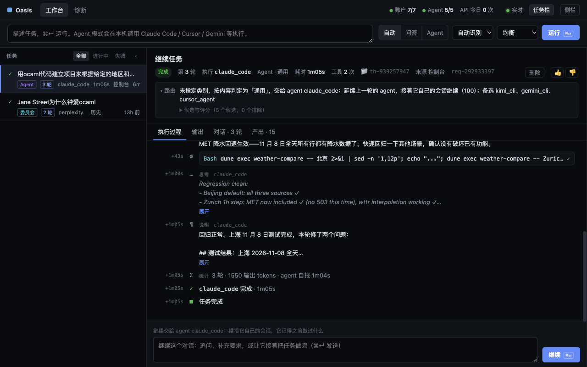
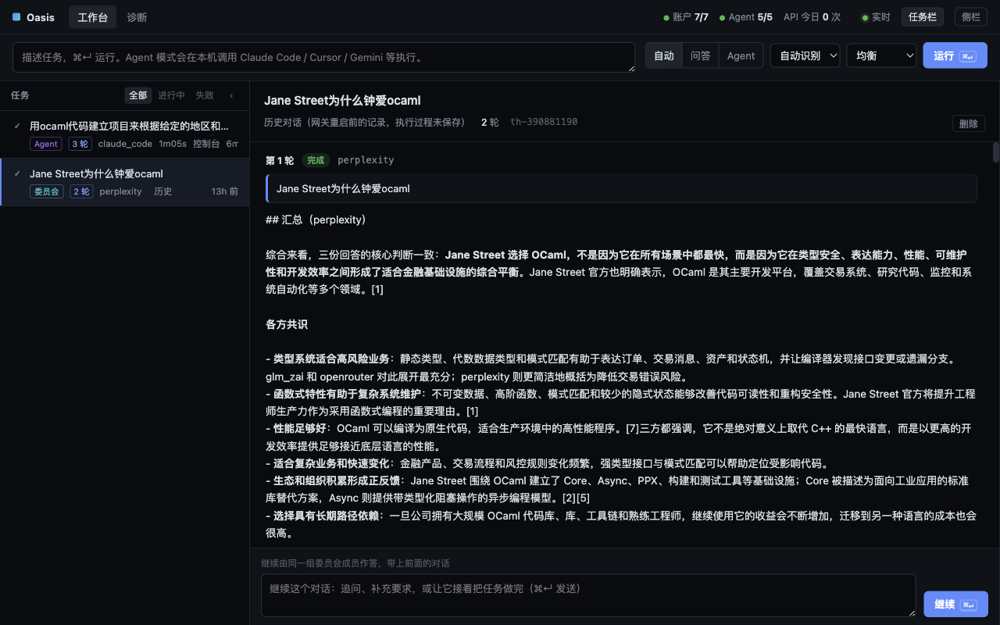
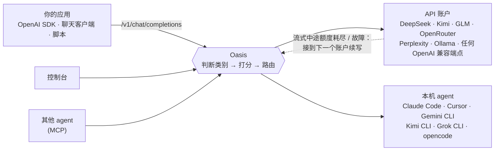

<div align="center">

# Oasis

**把你手上所有的 AI 账户和 coding agent，收进本机的一个入口。**

每个请求，Oasis 都替你挑最合适的模型或 agent；账户回答到一半额度用完了，它把流接到另一个账户继续写完，客户端完全感觉不到。

[English](README.md) · **简体中文**

</div>



## 为什么做 Oasis

你手上的 AI 多半已经用不过来了：DeepSeek 的 key、Kimi 的套餐、GLM、OpenRouter 的余额、Perplexity、本机的 Ollama，电脑上还装着 Claude Code、Cursor、Gemini CLI。它们各有所长，价格不同，限额也不同。于是每次都得手动挑，简单问题烧掉了旗舰模型，长回答写到一半还是撞上额度上限。

Oasis 挡在它们前面，每个请求都替你做这个选择。

## 你能得到什么

- **直接替换的 OpenAI 兼容接口**：任何客户端、SDK、聊天应用，把地址指向 `http://127.0.0.1:9899/v1`，`model` 填 `auto`，照常使用。流式和非流式都支持。
- **会解释自己的路由**：Oasis 先判断任务类别（编程、联网检索、写作、分析、通用），再按模型强项、价格、剩余预算、实时时延、健康度，以及从你过去的结果里学到的质量，给每个候选账户打分。目标由你定：均衡、最快、质量优先、最省钱。每一次决策和每个被排除的候选，控制台里都看得到。
- **流式中途无缝切换**：账户在流式输出时额度耗尽或断线，Oasis 从文字断开的地方接到下一个账户继续写，不重复一个字，客户端收到的是一条连续的回答。这是 Oasis 的招牌能力，自检一秒内就能演示出来。
- **本机 agent 变成你的执行者**：需要工具的任务（写代码、跑命令、上网查资料）交给本机的 Claude Code、Cursor Agent、Gemini CLI、Kimi CLI、Grok CLI 或 opencode。思考、工具调用、输出实时可见。每个对话有自己的工作目录；追问时 agent 接着自己的会话继续，记得之前做过什么。
- **委员会模式**：一个问题同时问最多三个账户，汇总成一份回答，标明共识和分歧。
- **真正好用的控制台** `http://127.0.0.1:9899/`：任务列表、路由说明、实时过程、产出文件，可以追问、停止、删除。
- **MCP 服务** `POST /mcp`：别的 agent 可以通过 Oasis 调模型、把任务交给你的本机 agent、互相发消息。
- **小而私密**：一个不到 10 MB 的二进制文件，路由决策约 2 微秒。所有状态都在本机的 `~/.oasis`，API key 只放环境变量，从不写进配置文件。



## 工作原理



## 快速开始

需要 macOS 或 Linux，以及 [Riot](https://github.com/leostera/riot) OCaml 工具链。

```bash
curl -sSL https://get.riot.ml | sh                 # 安装 Riot
git clone https://github.com/vajraimb/oasis.git && cd oasis
riot plan > /dev/null && scripts/patch-riot.sh      # 给 Riot 0.0.43 打两个运行时补丁
riot build
scripts/oasis.sh --self-test                        # 不需要任何 API key
```

自检会启动模拟上游，跑四项端到端检查：路由、遇到 `429` 自动回退、流式输出，以及流式回答中途被切断、由另一个账户续写完成且零重复。

然后加上你自己的账户：

```bash
mkdir -p ~/.oasis && cp config/oasis.example.toml ~/.oasis/oasis.toml   # 也可以让首次启动自动生成一份最简配置
$EDITOR ~/.oasis/oasis.toml                        # 只保留你手上有的账户和 agent
export DEEPSEEK_API_KEY=sk-...                     # key 放在 shell 里，比如 ~/.zshrc
scripts/oasis.sh start
open http://127.0.0.1:9899/
```

`scripts/oasis.sh` 还支持 `stop`、`restart`、`status`、`logs`；其他参数原样交给 `oasis` 程序，所以 `scripts/oasis.sh ask "你好" --stream`、`scripts/oasis.sh models` 也能用。

## 从任何地方调用

**curl**

```bash
curl -N http://127.0.0.1:9899/v1/chat/completions \
  -H 'Content-Type: application/json' \
  -H 'X-Oasis-Goal: cheapest' \
  -d '{"model": "auto", "messages": [{"role": "user", "content": "用两句话解释 CRDT"}], "stream": true}'
```

**OpenAI SDK（Python）**

```python
from openai import OpenAI

client = OpenAI(base_url="http://127.0.0.1:9899/v1", api_key="unused")
reply = client.chat.completions.create(
    model="auto",  # 或填配置里的模型名，固定用它
    messages=[{"role": "user", "content": "写一首关于故障切换的俳句"}],
    extra_headers={"X-Oasis-Goal": "best"},
)
print(reply.choices[0].message.content)
```

**把真正的任务交给本机 agent**

```bash
curl -N http://127.0.0.1:9899/v1/chat/completions \
  -H 'Content-Type: application/json' -H 'X-Oasis-Mode: agent' \
  -d '{"model": "auto", "stream": true, "messages": [{"role": "user",
       "content": "写一个命令行工具，对比三个天气数据源对明天的预报"}]}'
```

响应头里有 `X-Oasis-Thread`。下一条消息带上它，同一个 agent 就会在同一个工作目录里接着做。

### 请求头

全部可选；不给时 Oasis 按内容自己判断。

| 请求头 | 作用 |
|---|---|
| `X-Oasis-Mode` | `chat`（问答）或 `agent` |
| `X-Oasis-Category` | `coding`、`research`、`writing`、`analysis` 或 `general` |
| `X-Oasis-Goal` | `balanced`、`fastest`、`best` 或 `cheapest` |
| `X-Oasis-Agent` | 指定某个 agent 执行 |
| `X-Oasis-Committee` | 一起作答的账户，逗号分隔 |
| `X-Oasis-Thread` | 续接对话 |
| `X-Oasis-Timeout` | 时限（秒）；不给就一直执行到完成或被你停止 |

`model` 填 `auto`、`oasis` 或留空，由 Oasis 路由；填配置里的模型名，就固定用那个模型。

## 配置

所有配置都在 `~/.oasis/oasis.toml`。[`config/oasis.example.toml`](config/oasis.example.toml) 是一份带中英注释的起点，涵盖模型、账户和所有支持的 agent。配置里声明三类东西：

- **models**：每个模型擅长什么、上下文长度、时延、价格；
- **accounts**：端点、存 key 的环境变量名、提供哪些模型、限速和预算；
- **agents**：CLI 命令，以及让它无人值守运行的参数。

routes 再规定每个类别允许哪些账户执行。改完配置调用 `POST /api/reload`，或者重启。

运行时文件：

```
~/.oasis/                  （OASIS_HOME 可改）
├── oasis.toml             配置
├── data/                  对话、路由决策、成本账本、学到的质量与时延
├── workspaces/<对话 id>/  每个对话一个工作目录，agent 的产出都在这里
└── logs/oasis.log
```

Oasis 默认只监听 `127.0.0.1`。要开放到网络上，先设置 `auth_token_env`，让每个请求都必须带 Bearer token；监听非回环地址却没设置时，Oasis 会拒绝启动。agent 以你的用户权限运行，只交给它你自己也会执行的任务。

## 项目状态

Oasis 还很年轻，目前作为单用户、单机网关每天在用。需要知道的：

- 控制台和命令行输出目前是中文；API 本身与语言无关。
- 并行跑测试偶尔会在 Riot 运行时里崩溃，请串行运行（见下方）。
- [docs/oasis-spec.md](docs/oasis-spec.md) 详细记录了调度算法、无缝切换状态机、安全边界、持久化语义和已知限制。

欢迎提 issue 和 pull request。

## 开发

```bash
riot build
riot test -p oasis -- --concurrency 1   # 网关测试，串行
riot test -p oasis_net
riot bench -p oasis
bash scripts/build-release.sh           # release 二进制输出到 dist/
```

```
packages/
├── net/       oasis_net：TCP 连接池（Atacama）、HTTP/1.1 + WebSocket（Nomad）、中间件与路由（Trail）
└── oasis/     网关本体：src/oasis_*.ml、tests/、bench/、examples/（模拟上游、HTTPS 探针）
config/        oasis.example.toml、oasis-demo.toml（对着本机模拟上游的无 key 演示）
scripts/       oasis.sh、build-release.sh、patch-riot.sh
patches/riot/  Riot kernel/std 补丁（CI 和本地构建都会打）
```
